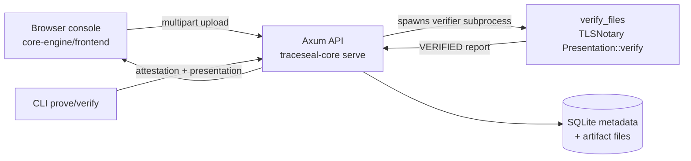

# TRACESEAL — Sponsor Demonstration

## What TRACESEAL is

TRACESEAL turns a live HTTPS response into **cryptographically verifiable evidence**. Using [TLSNotary](https://tlsnotary.org) MPC-TLS, it proves what a server actually returned — without trusting the client, the server, or TRACESEAL itself. Anyone can later re-verify the proof and detect any tampering.

## The problem

Screenshots, logs, and API responses are trivially forgeable. When a service says "we returned HTTP 503 with this error," there is no way to prove it after the fact. TRACESEAL produces a portable, independently verifiable proof artifact plus a canonical evidence record with a commitment hash.

## Why it matters

- **Auditability:** evidence can be re-verified years later by anyone holding the artifacts.
- **Tamper evidence:** a single flipped byte in a presentation is rejected by the real TLSNotary verifier.
- **Selective disclosure:** only chosen response fields are revealed; the rest of the transcript stays private.
- **Integrity chain:** evidence ID = `ts1_<sha256>` over an RFC 8785 canonical payload binding the proof hashes, disclosed fields, verifier version, and trust policy.

## Architecture (simple version)

Data flow: a genuine TLSNotary attestation/presentation/request-manifest package is uploaded → the API stages it → a **separate verifier process** runs the pinned TLSNotary `Presentation::verify` → only on `VERIFIED` does the engine build the Evidence Schema 1.0 record (commitment + `ts1_` ID) → SQLite stores metadata and immutable verification reports → artifact bytes are stored under `artifacts/<evidence-id>/` → retrieval re-hashes everything.

## Live demonstration sequence

1. **Start the fixture** (test HTTPS service on `127.0.0.1:4443`):
   `traceseal-core fixture`
2. **Start the API + console** (`127.0.0.1:3000`):
   `traceseal-core serve --bind 127.0.0.1:3000 --storage-dir demo-store`
3. **Open** `http://127.0.0.1:3000` — health badge shows `healthy · schema 1.0 · demo-local-v1`.
4. **Generate a genuine proof** (second terminal, test key via env var):
   `traceseal-core prove --url https://localhost:4443/trace-seal-503 --disclose status,error,service,message --output demo-artifacts`
5. **Submit** `attestation.tlsn`, `presentation.tlsn`, `request.json` through the console's file inputs → receipt shows `stored` + `ts1_…` evidence ID.
6. **Look up** the evidence ID → disclosed fields (`status: 503`, `error`, `service`, `message`), artifact download links, verification history.
7. **Re-verify** → a fresh verifier run appends a `REVERIFICATION` record.
8. **Tamper demo** → flip one byte in `presentation.tlsn`, resubmit → `422 VERIFICATION_REJECTED`.
9. **Restart** the server on the same `--storage-dir` → evidence and history persist.

## Honest limitations

- **Demo trust model:** the attestor key is public test material (`TRACESEAL_TEST_ATTESTOR_KEY`); prover and notary share a process. Production needs an independently governed notary.
- **Scope:** only `GET https://localhost:4443/trace-seal-{503,200,404,delay}` and four top-level JSON fields; TLS 1.2 only; no arbitrary hosts, TLS 1.3, auth, or multi-user ownership.
- **Hedera anchoring:** designed (anchor the `ts1_` commitment + artifact hashes to HCS) but **not implemented** — requires real testnet account/topic credentials.
- **Browser QA:** verified via HTTP-level checks and the preview proxy; pixel-level interactive browser testing was not fully automated.
